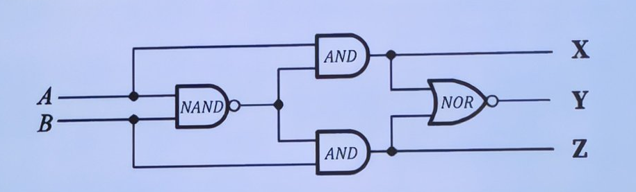

## 2026-2027学年上学期期中试卷

### 说明

本卷题面根据期中考试原卷整理，未找到参考答案，仅收录题面。

***

### 一、进制转换（20 分）

请完成下列数字的转换

1）十进制 25 等于八进制 $\underline{\qquad}$

    ***

2）二进制 10010110 等于十进制 $\underline{\qquad}$

    ***

3）十六进制 0xbeef 等于二进制 $\underline{\qquad}$

    ***

4）十进制 65535 等于十六进制 $\underline{\qquad}$

***

### 二、真值表（20 分）

请根据下面图中的逻辑电路，写出它的输入和输出对应的真值表，并简单总结它的功能

| A | B | X | Y | Z |
|---|---|---|---|---|
| 0 | 0 |   |   |   |
| 0 | 1 |   |   |   |
| 1 | 0 |   |   |   |
| 1 | 1 |   |   |   |

功能总结：

***

### 三、1 在哪里（30 分）

在组合逻辑电路设计中，有这么一种电路，它的输入为 4 个信号（分别记为 A、B、C、D），而输出则有两个信号（分别记为 $X_0$ 和 $X_1$）；输出信号的组合（00、01、10、11）分别代表了输入 A 为 1（无论 BCD 为何值）、输入 B 为 1（且 A 为 0，无论 CD 为何值）、输入 C 为 1（且 AB 均为 0，无论 D 为何值）、输入 D 为 1（且 ABC 均为 0）这四类情况。请在下面画出电路结构，你只能使用基本门电路（与门、或门、非门、与非门、或非门；与门和或门可以接入 3 路信号）。

*附加分：当输入 ABCD 全为 0 的特殊情况下，增加一个额外输出 Y 为 0，同时 $X_0$ 和 $X_1$ 也为 0；其他情况下 Y 为 1*

*提示：如果逻辑关系想不清楚，就把真值表先写出来*

***

### 四、隐藏的扑克牌（30 分）

有这么一个魔术。魔术师拿出一副去掉大小王的扑克牌（52 张牌，黑红梅方各 13 张）。观众（不是托！）随机抽取 5 张牌交给魔术师的助手（助手当然和魔术师事先商量好了）。助手看过这 5 张牌后，选择其中的 1 张牌藏起来，然后把剩下 4 张牌按某个特定顺序摆成一排给魔术师看。魔术师看到这 4 张牌的顺序，就能说出刚才藏起来的那张牌的花色 + 点数。请聪明的你分析一下，魔术师的助手是怎么传递这张藏起来的牌的信息的？

- 提示 1：助手并不是随机选择一张牌然后藏起来，而是先分析了这五张牌的模式，选择其中特定的一张；仔细想想扑克有几种花色？
- 提示 2：信息的传递，并不一定要用"数字是几"来传统，也可以用数字的其他性质（比如数字之间的关系）来表示，思考一下你会用什么样的模式去代表什么样的信息，一定不要被传统的方法束缚了思路。
