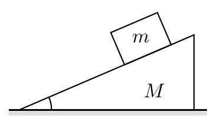
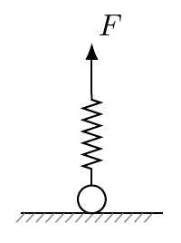
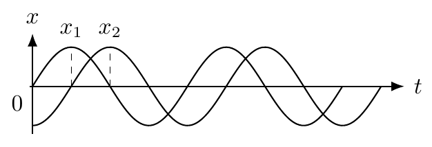
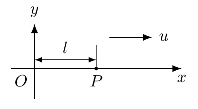
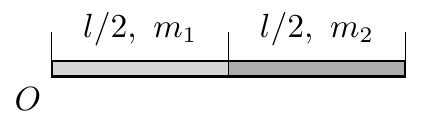
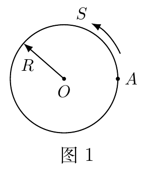
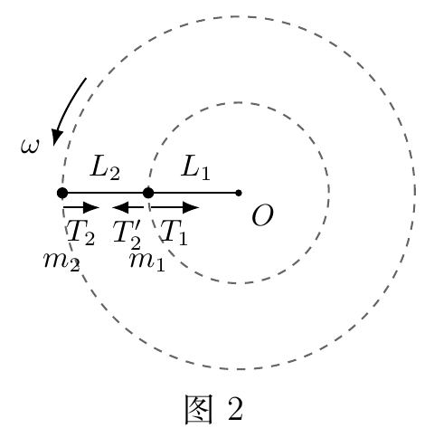
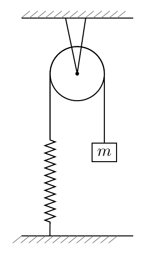

## 2025-2026学年上学期期中试卷（含答案）

大学物理 C（PHYS2647），试卷满分 100 分。题面及插图据 2025 年期中试卷整理，题下附参考答案与解析。

### 一、选择题（24 分，共 8 小题，每小题 3 分）

1. 质量为 $m$ 的物体自空中静止下落，下落过程中，物体除受重力外，还受到一个与速度平方成正比的阻力的作用，即 $R=kv^2$，$k$ 为正常数。该下落物体的收尾速度（即最后物体作匀速直线运动的速度）将是（　　）。

    A. $\sqrt{\dfrac{mg}{k}}$

    B. $\dfrac{g}{2k}$

    C. $gk$

    D. $\sqrt{gk}$

    

    
答案：

    **A**。达到收尾速度时，加速度为零，重力与阻力大小相等，即 $mg=kv^2$，故 $v=\sqrt{mg/k}$。

    

    ***

2. 如图所示，一质量为 $M$ 的斜面原来静止在光滑水平面上，将一块质量为 $m$ 的木块轻轻放于斜面。如果此后木块相对斜面滑动，则斜面将（　　）。

    

    A. 保持静止

    B. 向右加速运动

    C. 向右匀速运动

    D. 向左加速运动

    

    
答案：

    **B**。系统水平方向无外力，初始静止，所以质心的水平坐标固定。令斜面的水平位移向右为正，记为 $X$，木块沿斜面下滑的相对位移记为 $s$，倾角为 $\alpha$。按图中斜面方向，木块相对地面的水平位移为 $X-s\cos\alpha$，故 $X=\dfrac{m}{M+m}s\cos\alpha$。木块从相对静止开始沿斜面向左下方加速滑动，因而斜面向右加速。

    

    ***

3. 如图所示，有一劲度系数为 $k$ 的轻弹簧，竖直放置，下端悬一质量为 $m$ 的小球，开始时使弹簧为原长而小球恰好与地接触，今将弹簧上端缓慢地提起，直到小球刚能脱离地面为止，在此过程中外力作功为（　　）。

    

    A. $\dfrac{m^2g^2}{4k}$

    B. $\dfrac{m^2g^2}{3k}$

    C. $\dfrac{m^2g^2}{2k}$

    D. $\dfrac{2m^2g^2}{k}$

    

    
答案：

    **C**。小球刚脱离地面时，地面的支持力变为零，由 $kx=mg$ 得弹簧伸长量 $x=mg/k$。在刚离地之前，小球的高度保持不变，外力所做的功等于弹簧弹性势能的增加量，即 $W=\dfrac{1}{2}kx^2=\dfrac{m^2g^2}{2k}$。

    

    ***

4. 花样滑冰运动员绕过通过自身的竖直转轴转动，开始时两臂伸开，转动惯量为 $J_0$，角速度为 $\omega_0$。然后她将双臂收回，使转动惯量减少为 $J_0/3$，这时她转动的角速度变为（　　）。

    A. $\dfrac{\omega_0}{3}$

    B. $\dfrac{\omega_0}{\sqrt{3}}$

    C. $\sqrt{3}\,\omega_0$

    D. $3\omega_0$

    

    
答案：

    **D**。对竖直转轴的合外力矩可忽略，角动量守恒，因此 $J_0\omega_0=\dfrac{J_0}{3}\omega$，解得 $\omega=3\omega_0$。

    

    ***

5. 已知两个简谐振动如图所示，则 $x_1$ 的相位比 $x_2$ 的相位（　　）。

    

    A. 落后 $\pi/2$

    B. 超前 $\pi/2$

    C. 落后 $\pi$

    D. 超前 $\pi$

    

    
答案：

    **B**。$x_1$ 的波峰比 $x_2$ 早出现四分之一个周期，故 $x_1$ 的相位比 $x_2$ 超前 $2\pi\times\dfrac{1}{4}=\dfrac{\pi}{2}$。

    

    ***

6. 一平面简谐波在弹性媒质中传播，在媒质质元从最大位移处回到平衡位置的过程中，以下说法正确的是（　　）。

    A. 它的势能转换成动能

    B. 它的动能转换成势能

    C. 它从相邻的一段媒质质元获得能量，其能量逐渐增加

    D. 它把自己的能量传给相邻的一段媒质质元，其能量逐渐减小

    

    
答案：

    **C**。在平面简谐行波中，质元的动能密度和弹性势能密度分别正比于 $\left(\partial y/\partial t\right)^2$ 和 $\left(\partial y/\partial x\right)^2$，二者同相变化。质元从最大位移处回到平衡位置时，两项都从零增大，因此该质元净获得能量。

    

    ***

7. 如图所示，一平面简谐波沿 $x$ 轴正向传播，已知 $P$ 点的振动方程为 $y=A\cos(\omega t+\phi_0)$，则波的表达式为（　　）。

    

    A. $y=A\cos\{\omega[t-(x-l)/u]+\phi_0\}$

    B. $y=A\cos\{\omega[t-(x/u)]+\phi_0\}$

    C. $y=A\cos\omega(t-x/u)$

    D. $y=A\cos\{\omega[t+(x-l)/u]+\phi_0\}$

    

    
答案：

    **A**。图中 $P$ 点位于 $x=l$。波沿 $x$ 轴正向传播，位置 $x$ 处的振动相对 $P$ 点有时间延迟 $(x-l)/u$，把 $P$ 点振动方程中的 $t$ 换成 $t-(x-l)/u$ 即得。

    

    ***

8. 把单摆摆球从平衡位置向位移正方向拉开，使摆线与竖直方向成一微小角度 $\theta$，然后由静止放手任其振动，从放手时开始计时。若用余弦函数表示其运动方程，则该单摆振动的初相为（　　）。

    A. $\pi$

    B. $\pi/2$

    C. $0$

    D. $\theta$

    

    
答案：

    **C**。放手时位移为正的最大值，速度为零。在 $x=A\cos(\omega t+\phi_0)$ 中代入 $t=0$ 和 $x=A$，得 $\phi_0=0$（模 $2\pi$）。

    

***

### 二、填空题（26 分，共 13 空，每空 2 分）

1. 一质量为 $m$ 的质点在指向圆心的平方反比力 $F=-k/r^2$ 的作用下，作半径为 $r$ 的圆周运动。此质点的速度 $v=\underline{\qquad}$。若取距圆心无穷远处为势能零点，它的机械能 $E=\underline{\qquad}$。

    

    
答案：

    $v=\sqrt{\dfrac{k}{mr}}$，$E=-\dfrac{k}{2r}$。

    由 $mv^2/r=k/r^2$ 得速率。按题设选取势能零点时，$U(r)=-k/r$，且 $K=\dfrac{1}{2}mv^2=k/(2r)$，所以 $E=K+U=-k/(2r)$。

    

    ***

2. 在几个力的同时作用下，一质点的位移 $\Delta\vec r=4\vec i-5\vec j\ (\mathrm{m})$，其中一个力是恒力，其表达式为 $\vec F=-3\vec i-5\vec j\ (\mathrm{N})$，则该恒力在这一过程中作的功 $A=\underline{\qquad}$。

    

    
答案：

    $13\ \mathrm{J}$。恒力做功为 $A=\vec F\cdot\Delta\vec r=(-3)\times4+(-5)\times(-5)=13\ \mathrm{J}$。

    

    ***

3. 一长为 $l$、质量为 $m$ 的均质链条，放在光滑的桌面上，若其长度的 $1/5$ 悬挂于桌边下，将其慢慢拉回桌面，需做功 $\underline{\qquad}$。

    

    
答案：

    $\dfrac{mgl}{50}$。悬垂部分质量为 $m/5$，质心升高 $l/10$。缓慢拉动时，所做的功等于重力势能的增加量，$W=(m/5)g(l/10)$。

    

    ***

4. 如图所示，长度 $l$ 的细棒左半部分质量 $m_1$ 且其分布均匀，右半部分质量 $m_2$ 且其分布也是均匀的，则该细棒绕过左端点 $O$ 垂直于棒的轴转动时，其转动惯量是 $\underline{\qquad}$。

    

    

    
答案：

    $\dfrac{(m_1+7m_2)l^2}{12}$。

    以左端点为 $x=0$，两半的线密度分别为 $2m_1/l$ 与 $2m_2/l$。对两半分别积分可得

    $$
    J=\frac{2m_1}{l}\int_0^{l/2}x^2\,\mathrm{d}x+
      \frac{2m_2}{l}\int_{l/2}^{l}x^2\,\mathrm{d}x
      =\frac{(m_1+7m_2)l^2}{12}.
    $$

    

    ***

5. 一平面简谐波的表达式为 $y=0.025\cos(125t-0.37x)$（SI），其角频率 $\omega=\underline{\qquad}$，波速 $u=\underline{\qquad}$，波长 $\lambda=\underline{\qquad}$。

    

    
答案：

    $\omega=125\ \mathrm{rad/s}$，$u\approx337.84\ \mathrm{m/s}$，$\lambda\approx16.98\ \mathrm{m}$。

    与 $A\cos(\omega t-kx)$ 对照可知波数 $k=0.37\ \mathrm{rad/m}$，故 $u=\omega/k$，$\lambda=2\pi/k$。

    

    ***

6. 一质量为 $m$ 的质点沿着一条曲线运动，其位置矢量在空间直角坐标系中的表达式为 $\vec r=a\cos\omega t\,\vec i+b\sin\omega t\,\vec j$，其中 $a$、$b$、$\omega$ 均为常量，则此质点对原点的角动量大小 $L=\underline{\qquad}$；此质点所受对原点的力矩大小 $M=\underline{\qquad}$。

    

    
答案：

    $L=|mab\omega|$，$M=0$。

    对 $\vec r$ 求导得
    $\vec v=-a\omega\sin\omega t\,\vec i+b\omega\cos\omega t\,\vec j$，故
    $\vec L=\vec r\times m\vec v=mab\omega\,\vec k$。再次求导得 $\vec a=-\omega^2\vec r$，因此 $\vec r\times m\vec a=\vec 0$。

    

    ***

7. 在相对地面静止的坐标系内，A、B 二船都以 $2\ \mathrm{m/s}$ 速率匀速行驶，A 船沿 $x$ 轴正向，B 船沿 $y$ 轴正向。今在 A 船上设置与静止坐标系方向相同的坐标系（$x$、$y$ 方向单位矢用 $\vec i$、$\vec j$ 表示），那么在 A 船上的坐标系中，B 船的速度（以 $\mathrm{m/s}$ 为单位）为 $\underline{\qquad}$。

    

    
答案：

    $-2\vec i+2\vec j$。以地面为参考系，用 B 船的速度减去 A 船的速度，即 $\vec v_{B/A}=\vec v_{B/\text{地}}-\vec v_{A/\text{地}}$。

    

    ***

8. 火车以 $90\ \mathrm{km/h}$ 的速度行驶，汽笛频率为 $500\ \mathrm{Hz}$；（1）人站在铁轨旁，当火车从他身边驶过，在火车靠近和远离他前后，他听到的汽笛声的频率变化是 $\underline{\qquad}$，声速为 $340\ \mathrm{m/s}$；（2）若此人坐在汽车里，而汽车在铁轨旁的公路上以 $54\ \mathrm{km/h}$ 的速率迎着火车行驶，此人听到的汽笛声频率是 $\underline{\qquad}$。

    

    
答案：

    （1）由 $539.68\ \mathrm{Hz}$ 降至 $465.75\ \mathrm{Hz}$。（2）$563.49\ \mathrm{Hz}$。

    火车速度为 $25\ \mathrm{m/s}$，汽车速度为 $15\ \mathrm{m/s}$。人站在轨旁时，火车靠近与远离对应的频率分别为

    $$
    f_{\text{近}}=500\frac{340}{340-25}\ \mathrm{Hz}\approx539.68\ \mathrm{Hz},
    \qquad
    f_{\text{远}}=500\frac{340}{340+25}\ \mathrm{Hz}\approx465.75\ \mathrm{Hz}.
    $$

    汽车与火车相向运动时，听到的频率为
    $f'=500\dfrac{340+15}{340-25}\ \mathrm{Hz}\approx563.49\ \mathrm{Hz}$。

    

***

### 三、计算题（50 分，共 5 题，每题 10 分）

1. 质点沿半径 $R=3\ \mathrm{m}$ 的圆周运动，如图 1。已知切向加速度 $a_\tau=3\ \mathrm{m\cdot s^{-2}}$，$t=0$ 时质点在 $A$ 点，其速度 $v_0=0$，试求：

    

    （1）$t=1\ \mathrm{s}$ 时质点速度和加速度的大小。（5 分）

    

    
答案：

    速率为 $3\ \mathrm{m/s}$，加速度大小为 $3\sqrt{2}\ \mathrm{m/s^2}$。由 $v=v_0+a_\tau t$，得 $t=1\ \mathrm{s}$ 时 $v=3\ \mathrm{m/s}$。此时法向加速度为 $a_n=v^2/R=3\ \mathrm{m/s^2}$，故 $a=\sqrt{a_\tau^2+a_n^2}=3\sqrt{2}\ \mathrm{m/s^2}$。

    

    （2）第 2 秒内质点所通过的路程。（5 分）

    

    
答案：

    $4.5\ \mathrm{m}$。第 2 秒内对应 $t=1\ \mathrm{s}$ 至 $t=2\ \mathrm{s}$。质点速率为 $v=a_\tau t$，故路程为

    $$
    \Delta s=\int_{1\ \mathrm{s}}^{2\ \mathrm{s}} a_\tau t\,\mathrm{d}t
    =\frac{1}{2}a_\tau[(2\ \mathrm{s})^2-(1\ \mathrm{s})^2]
    =4.5\ \mathrm{m}.
    $$

    

    ***

2. 坐在转椅上的人手握哑铃，两臂伸直时，人、哑铃和转椅系统对竖直轴的转动惯量为 $J_1=2\ \mathrm{kg\cdot m^2}$，在外人推动后，此系统开始以 $n_1=15\ \mathrm{r/min}$ 转动。

    当人的两臂收回，使系统的转动惯量变为 $J_2=0.8\ \mathrm{kg\cdot m^2}$ 时，它的转速 $n_2$ 是多大？（4 分）

    

    
答案：

    $n_2=37.5\ \mathrm{r/min}$。收臂时，绕竖直轴的合外力矩可忽略，角动量守恒，$J_1\omega_1=J_2\omega_2$。转速与角速度成正比，因此 $n_2=(J_1/J_2)n_1=37.5\ \mathrm{r/min}$。

    

    两臂收回过程中，系统的机械能是否守恒？什么力做了功？做功多少？设轴上摩擦忽略不计。（6 分）

    

    
答案：

    机械能不守恒。肌肉施加的内力做正功 $\dfrac{3\pi^2}{8}\ \mathrm{J}\approx3.70\ \mathrm{J}$。

    $\omega_1=\dfrac{\pi}{2}\ \mathrm{rad/s}$，$\omega_2=\dfrac{5\pi}{4}\ \mathrm{rad/s}$。收臂过程中重力势能保持不变，机械能的增加量为

    $$
    \Delta E=\frac12 J_2\omega_2^2-\frac12 J_1\omega_1^2
    =\frac{3\pi^2}{8}\ \mathrm{J}.
    $$

    肌肉的内力做功使人体内的化学能转化为系统的机械能。在题设条件下，其功等于上述机械能增量。

    

    ***

3. 作简谐振动的小球，速度最大值为 $v_m=3\ \mathrm{cm/s}$，振幅 $A=2\ \mathrm{cm}$。若从速度为正的最大值的某时刻开始计算时间，求：

    （1）振动的周期。（3 分）

    

    
答案：

    $\dfrac{4\pi}{3}\ \mathrm{s}$。由 $v_m=\omega A$ 得 $\omega=1.5\ \mathrm{rad/s}$，故 $T=2\pi/\omega=\dfrac{4\pi}{3}\ \mathrm{s}$。

    

    （2）振动的表达式。（4 分）

    

    
答案：

    $x(t)=2\sin(1.5t)\ \mathrm{cm}$，其中 $t$ 以秒计。$t=0$ 时质点经过平衡位置且速度取正最大值。等价的余弦表达式为 $x(t)=2\cos(1.5t-\pi/2)\ \mathrm{cm}$。

    

    （3）加速度的最大值。（3 分）

    

    
答案：

    $a_{\max}=\omega^2 A=4.5\ \mathrm{cm/s^2}$。

    

    ***

4. 如图 2 所示，一个质量为 $m_1$ 的物体拴在长为 $L_1$ 的轻绳上，绳的另一端固定在一个水平光滑桌面的钉子上。另一物体质量为 $m_2$，用长为 $L_2$ 的绳与 $m_1$ 连接。二者均在桌面上做匀速圆周运动，假设 $m_1$、$m_2$ 的角速度为 $\omega$，求各段绳子上的张力。（10 分）

    

    

    
答案：

    两绳沿同一半径绷直，$m_1$ 和 $m_2$ 的运动半径分别为 $L_1$ 和 $L_1+L_2$。对外侧物体 $m_2$，只有外段绳的张力提供向心力。对内侧物体 $m_1$，内段绳的张力指向 $O$，外段绳的拉力背离 $O$。因此

    $$
    \begin{aligned}
    T_2 &= m_2\omega^2(L_1+L_2),\\
    T_1-T_2 &= m_1\omega^2 L_1.
    \end{aligned}
    $$

    内段张力为 $T_1=\omega^2[m_1L_1+m_2(L_1+L_2)]$，外段张力为 $T_2=m_2\omega^2(L_1+L_2)$。

    

    ***

5. 一定滑轮的半径为 $R$，转动惯量为 $J$，其上挂一轻绳，绳的一端系一质量为 $m$ 的物体，另一端与一固定的轻弹簧相连，如图所示。设弹簧的劲度系数为 $k$，绳与滑轮间无滑动，且忽略轴的摩擦力及空气阻力。现将物体 $m$ 从平衡位置拉下一微小距离后放手，证明物体做简谐振动，并求出其角频率。（10 分）

    

    

    
答案：

    以物体平衡位置为原点，向下为正，设物体位移为 $x$。物体下移 $x$ 时，弹簧上端上移 $x$，弹簧在平衡伸长量的基础上再伸长 $x$。设物体侧和弹簧侧张力分别为 $T_m$ 和 $T_s$。平衡时两侧张力均为 $mg$，运动时 $T_s=mg+kx$。

    取物体向下运动对应的转向为正。绳与滑轮间无滑动，因此角加速度 $\alpha=\ddot x/R$。物体的平动方程和滑轮的转动方程为

    $$
    m\ddot x=mg-T_m,\qquad
    (T_m-T_s)R=J\frac{\ddot x}{R}.
    $$

    消去张力，得

    $$
    \left(m+\frac{J}{R^2}\right)\ddot x+kx=0.
    $$

    上式是简谐振动方程，因此物体绕平衡位置做简谐振动，角频率为 $\omega=\sqrt{\dfrac{k}{m+J/R^2}}$。

    

