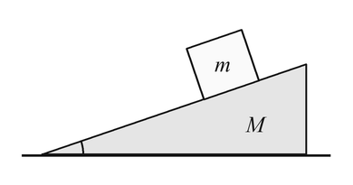
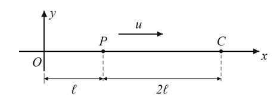
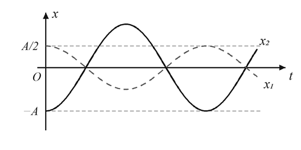
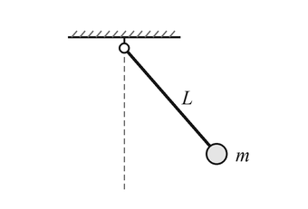
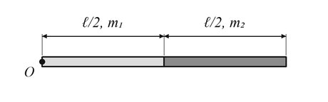
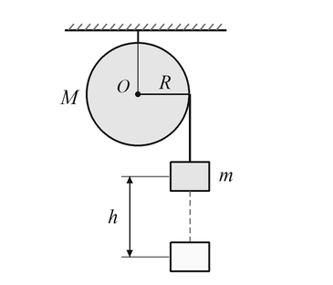
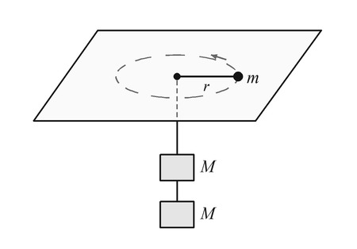
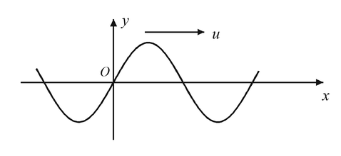
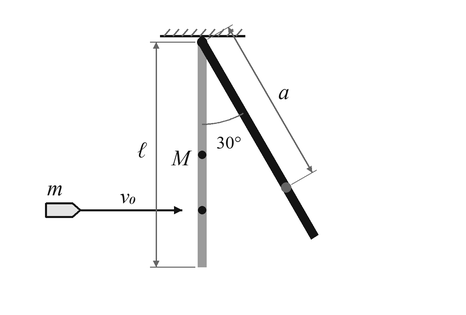

## 2026-2027学年上学期期中试卷（含答案）

> 大学物理 C（PHYS2647），满分 100 分。题面根据试卷照片整理，题图重绘，答案为独立推导的参考解答。

### 一、选择题（单项选择，每题 3 分，共 24 分）

1. 如图所示，一质量为 $M$ 的斜面原来静止在光滑水平面上，将一块质量为 $m$ 的木块轻轻放于 $M$ 的光滑斜面上。如果此后木块相对斜面滑动，则斜面将（ ）。

    

    A. 保持静止

    B. 向右加速运动

    C. 向右匀速运动

    D. 向左加速运动

    

    
答案

    **B**。 斜面对木块的支持力指向左上方。木块对斜面的压力指向右下方，其水平分量使斜面向右加速。

    

    ***

2. 质量为 $0.2\ \mathrm{kg}$ 的质点，其运动方程为 $x=4.5t^2-4t$，其中 $x$ 以米计算，$t$ 以秒计算。在 $2\ \mathrm{s}$ 末，该质点受到的合外力为（ ）。

    A. $0$

    B. $0.9\ \mathrm{N}$

    C. $0.7\ \mathrm{N}$

    D. $1.8\ \mathrm{N}$

    

    
答案

    **D**。 加速度为 $a=\mathrm{d}^2x/\mathrm{d}t^2=9\ \mathrm{m/s^2}$，合外力为 $ma=1.8\ \mathrm{N}$，沿 $x$ 轴正向。

    

    ***

3. 质量为 $m$ 的物体自空中静止下落。下落过程中，物体除受重力外，还受到一个与速度平方成正比的阻力，即 $R=kv^2$，$k$ 为正常数。该下落物体的收尾速度（极限速度）为（ ）。

    A. $\sqrt{\dfrac{mg}{k}}$

    B. $\dfrac{g}{2k}$

    C. $gk$

    D. $\sqrt{gk}$

    

    
答案

    **A**。 达到收尾速度时加速度为零，$mg=kv^2$，故 $v=\sqrt{mg/k}$。

    

    ***

4. 两块质量均为 $m$ 的木块 A 和 B 由一轻质弹簧连接，放在光滑水平面上。先使两木块靠近而将弹簧压缩，然后由静止释放。若在弹簧伸长到原长时，木块 B 的速度大小为 $v_1$，则释放瞬间弹簧所具有的弹性势能是（ ）。

    A. $\dfrac{1}{2}mv_1^2$

    B. $\dfrac{1}{4}mv_1^2$

    C. $2mv_1^2$

    D. $mv_1^2$

    

    
答案

    **D**。 水平方向动量守恒，两木块始终等速率、反向运动。弹簧恢复原长时，初始弹性势能全部转化为两木块的动能，故 $E_{\mathrm p}=2\times\dfrac12mv_1^2=mv_1^2$。

    

    ***

5. 花样滑冰运动员绕通过自身的竖直转轴转动，开始时两臂伸开，转动惯量为 $J_0$，角速度为 $\omega_0$。然后她将双臂收回，使转动惯量减少为 $J_0/3$，这时她转动的角速度为（ ）。

    A. $\dfrac{\omega_0}{3}$

    B. $\dfrac{\omega_0}{\sqrt{3}}$

    C. $\sqrt{3}\,\omega_0$

    D. $3\omega_0$

    

    
答案

    **D**。 忽略绕竖直轴的外力矩，由角动量守恒得 $J_0\omega_0=(J_0/3)\omega$，故 $\omega=3\omega_0$。

    

    ***

6. 如图，一平面简谐波以波速 $u$ 沿 $x$ 轴正方向传播，$O$ 为坐标原点。已知 $P$ 点的振动方程为 $y=A\cos\omega t$，则（ ）。

    

    A. $O$ 点的振动方程为 $y=A\cos\omega\left(t-\dfrac{\ell}{u}\right)$

    B. 波的表达式为 $y=A\cos\omega\left[t-\dfrac{\ell}{u}-\dfrac{x}{u}\right]$

    C. 波的表达式为 $y=A\cos\omega\left[t+\dfrac{\ell}{u}-\dfrac{x}{u}\right]$

    D. $C$ 点的振动方程为 $y=A\cos\omega\left(t-\dfrac{3\ell}{u}\right)$

    

    
答案

    **C**。 $P$ 点位于 $x=\ell$。对于沿 $+x$ 方向传播的波，$x$ 处的振动满足

    $$
    y(x,t)=y_P\left(t-\frac{x-\ell}{u}\right)
    =A\cos\left[\omega\left(t+\frac{\ell}{u}-\frac{x}{u}\right)\right].
    $$

    $O$ 点相对于 $P$ 点超前 $\ell/u$，$C$ 点相对于 $P$ 点滞后 $2\ell/u$。

    

    ***

7. 一平面简谐波在弹性媒质中传播，在某一瞬时，媒质中某质元正处于平衡位置，此时它的能量是（ ）。

    A. 动能最大，势能最大

    B. 动能为零，势能为零

    C. 动能为零，势能最大

    D. 动能最大，势能为零

    

    
答案

    **A**。 平面行波中，质元的动能密度正比于 $(\partial y/\partial t)^2$，弹性势能密度正比于 $(\partial y/\partial x)^2$。这两个量随相位同相变化，质元经过平衡位置时，振动速度和局部形变的大小都达到最大。

    

    ***

8. 图中所画的是两个简谐振动的振动曲线，分别记为 $x_1$ 和 $x_2$。若这两个简谐振动可叠加，且叠加后的振动方程采用 $x=A'\cos(\omega t+\varphi)$ 的表达形式，则合振动的初相 $\varphi$ 为（ ）。

    

    A. $\dfrac{3}{2}\pi$

    B. $\pi$

    C. $\dfrac{1}{2}\pi$

    D. $0$

    

    
答案

    **B**。 图中两振动同频反相，在 $t=0$ 时的位移分别为 $A/2$ 和 $-A$，均处在各自的位移极值处。合振动为 $x=-(A/2)\cos\omega t=(A/2)\cos(\omega t+\pi)$，故 $\varphi=\pi$。

    

***

### 二、填空题（每空 3 分，共 30 分）

1. 质量为 $0.25\ \mathrm{g}$ 的质点，受力 $\vec F=t\vec i\ (\mathrm{SI})$ 的作用。在 $t=0$ 时，该质点以 $\vec v_0=2\vec j\ (\mathrm{SI})$ 的速度通过坐标原点，则该质点在任意时刻的速度矢量是 $\underline{\qquad}$。

    

    
答案

    $\vec v=(2000t^2\vec i+2\vec j)\ \mathrm{m/s}$，其中 $t$ 以秒计。

    将质量换算为 $2.5\times10^{-4}\ \mathrm{kg}$。由牛顿第二定律，$a_x=4000t$、$a_y=0$，按初速度积分得 $v_x=2000t^2$、$v_y=2$。

    

    ***

2. 质量为 $1.0\ \mathrm{kg}$ 的质点，在沿 $x$ 轴方向的合外力作用下运动，其运动方程为 $x=3t-4t^2+t^3\ (\mathrm{SI})$。在 $0$ 到 $4\ \mathrm{s}$ 的时间间隔内，该质点所受合外力的冲量大小为 $\underline{\qquad}$。

    

    
答案

    $16\ \mathrm{N\cdot s}$。

    由 $v_x=3-8t+3t^2$ 得 $v_x(0)=3\ \mathrm{m/s}$、$v_x(4\ \mathrm{s})=19\ \mathrm{m/s}$。由动量定理，冲量大小为 $m|v_x(4\ \mathrm{s})-v_x(0)|=16\ \mathrm{N\cdot s}$。

    

    ***

3. 在几个力的同时作用下，一质点的位移 $\Delta\vec r=(4\vec i-5\vec j)\ \mathrm{m}$。其中一个力是恒力，其表达式为 $\vec F=(-3\vec i-5\vec j)\ \mathrm{N}$。则该恒力在这一过程中做的功 $A=\underline{\qquad}$。

    

    
答案

    $13\ \mathrm{J}$。

    $A=\vec F\cdot\Delta\vec r=[(-3)\times4+(-5)\times(-5)]\ \mathrm{J}=13\ \mathrm{J}$。

    

    ***

4. 甲、乙、丙三个物体做直线运动，质量比为 $1:2:3$。若它们的动能相等，且作用于每一个物体上的制动力大小都相同，方向与各自的速度方向相反，则它们的制动距离之比是 $\underline{\qquad}$。

    

    
答案

    $1:1:1$。

    由动能定理，制动至静止时有 $-Fs=0-E_{\mathrm k}$。三者的初始动能 $E_{\mathrm k}$ 与制动力大小 $F$ 分别相等，因此制动距离 $s=E_{\mathrm k}/F$ 相等。

    

    ***

5. 当两列波长都是 $\lambda$，振幅相同、频率相同、振动方向也相同的波，在同一直线上沿着相反方向传播并发生叠加时，就会形成 $\underline{\qquad}$，相邻波腹与波节之间的距离是 $\underline{\qquad}$。

    

    
答案

    驻波，$\dfrac{\lambda}{4}$。

    相邻波节相距 $\lambda/2$，波腹位于两个相邻波节的中点。

    

    ***

6. 一弹簧振子作简谐振动，总能量为 $E_1$。如果简谐振动振幅增加为原来的两倍，重物的质量增加为原来的四倍，则它的总能量 $E_2$ 与 $E_1$ 之间的关系为 $\underline{\qquad}$。

    

    
答案

    $E_2=4E_1$。

    在位移极值处，振动能量全部为弹性势能 $E=\dfrac12kA^2$。使用同一弹簧时，劲度系数 $k$ 相同，振幅变为两倍使能量变为四倍。

    

    ***

7. 一长为 $L$、质量可以忽略的直杆，可绕通过其一端的水平光滑轴在竖直平面内作定轴转动，在杆的另一端固定着一质量为 $m$ 的小球，如图所示。现将杆由水平位置无初转速地释放。则杆刚被释放时的角加速度 $\alpha_0=\underline{\qquad}$，小球到达竖直位置时的角速度为 $\underline{\qquad}$。

    

    

    
答案

    $\dfrac{g}{L}$，$\sqrt{\dfrac{2g}{L}}$（均取大小）。

    释放时重力力矩的大小为 $mgL$，转动惯量为 $mL^2$，故 $\alpha_0=g/L$。转至竖直向下位置时，小球下降 $L$，由机械能守恒得 $mgL=\dfrac12mL^2\omega^2$。

    

    ***

8. 如图所示，长度为 $\ell$ 的细棒左半部分质量为 $m_1$ 且分布均匀，右半部分质量为 $m_2$ 且分布也均匀。该细棒绕过左端点 $O$ 且垂直于棒的轴转动时，其转动惯量是 $\underline{\qquad}$。

    

    

    
答案

    $J=\dfrac{(m_1+7m_2)\ell^2}{12}$。

    取沿棒向右的坐标 $x$，原点为 $O$。左右半段的线密度分别为 $2m_1/\ell$、$2m_2/\ell$，故

    $$
    J=\frac{2m_1}{\ell}\int_0^{\ell/2}x^2\,\mathrm{d}x
    +\frac{2m_2}{\ell}\int_{\ell/2}^{\ell}x^2\,\mathrm{d}x
    =\frac{m_1\ell^2}{12}+\frac{7m_2\ell^2}{12}.
    $$

    

***

### 三、（8 分）

一质点沿 $x$ 轴作直线运动，其位置坐标与时间的关系为 $x=10+8t-4t^3$，其中 $x$ 以米计算，$t$ 以秒计算。求质点在 $t=0$ 和 $t=1\ \mathrm{s}$ 时的速度和加速度。

解答

在国际单位制下，对 $x$ 依次求导得

$$
v_x=\frac{\mathrm{d}x}{\mathrm{d}t}=8-12t^2,\qquad
a_x=\frac{\mathrm{d}v_x}{\mathrm{d}t}=-24t.
$$

| 时刻 | 速度 $v_x$ | 加速度 $a_x$ |
| --- | --- | --- |
| $t=0$ | $8\ \mathrm{m/s}$ | $0$ |
| $t=1\ \mathrm{s}$ | $-4\ \mathrm{m/s}$ | $-24\ \mathrm{m/s^2}$ |

***

### 四、（8 分）

一个质量为 $M$、半径为 $R$ 的定滑轮（看作均匀圆盘）上绕有细绳，绳的一端固定在滑轮边上，另一端挂一质量为 $m$ 的物体而下垂，如图所示。忽略轴处摩擦，圆盘对中心轴的转动惯量为 $J=MR^2/2$。求物体 $m$ 由静止下落高度 $h$ 时的速度。

解答

细绳从轮缘展开，物体的速率与滑轮角速度满足 $v=R\omega$。由机械能守恒，

$$
mgh=\frac12mv^2+\frac12J\omega^2
=\frac12\left(m+\frac M2\right)v^2.
$$

因此物体的速度竖直向下，大小为

$$
v=\sqrt{\frac{2mgh}{m+M/2}}=\sqrt{\frac{4mgh}{2m+M}}.
$$

***

### 五、（10 分）

在光滑平板中央有一个光滑小孔，细线一端系一个质量为 $m=0.050\ \mathrm{kg}$ 的小球，另一端穿过小孔后挂一个质量为 $M=0.100\ \mathrm{kg}$ 的重物，如图所示。小球以半径 $r=0.124\ \mathrm{m}$ 做匀速圆周运动时，重物达到平衡。在重物 $M$ 的下方再挂同质量的另一重物并达到平衡时，小球做匀速圆周运动的角速度和半径分别是多少？

解答

设增挂前的角速度为 $\omega$，增挂并达到平衡后的半径和角速度分别为 $r'$、$\omega'$。悬挂重物平衡时，绳的张力等于所挂重物的总重力，并为小球提供向心力，因此

$$
m\omega^2r=Mg,\qquad m(\omega')^2r'=2Mg.
$$

绳的拉力始终通过小孔，对过小孔的竖直轴无力矩，小球关于该轴的角动量守恒，

$$
mr^2\omega=m(r')^2\omega'.
$$

联立得 $(r')^3=r^3/2$。取 $g=9.8\ \mathrm{m/s^2}$，得到

$$
r'=\frac{r}{\sqrt[3]{2}}\approx0.0984\ \mathrm{m},\qquad
\omega'=2^{2/3}\sqrt{\frac{Mg}{mr}}\approx20.0\ \mathrm{rad/s}.
$$

***

### 六、（10 分）

某平面简谐波沿 $x$ 轴正向传播，其振幅和角频率分别为 $A$ 和 $\omega$，波速为 $u$。设 $t=0$ 时的波形如图所示。

（1）写出此波的表达式。

（2）求距 $O$ 点为 $\lambda/8$ 处质点的振动方程。

（3）求 $x=\lambda/8$ 处质点在 $t=0$ 时的振动速度。

解答

（1）设波数 $k=\omega/u=2\pi/\lambda$。初始波形经过原点，且在原点处空间斜率为正，因此 $y(x,0)=A\sin kx$。波沿 $+x$ 方向传播，故

$$
y(x,t)=A\sin(kx-\omega t)
=A\sin\left[\omega\left(\frac{x}{u}-t\right)\right].
$$

（2）按第（3）问所指定的质点取 $x=\lambda/8$，由 $kx=\pi/4$ 得

$$
y\left(\frac{\lambda}{8},t\right)=A\sin\left(\frac{\pi}{4}-\omega t\right)
=A\cos\left(\omega t+\frac{\pi}{4}\right).
$$

（3）保持 $x$ 固定，对 $t$ 求偏导，

$$
v_y=\frac{\partial y}{\partial t}=-A\omega\cos(kx-\omega t).
$$

代入 $x=\lambda/8$ 和 $t=0$，得 $v_y=-A\omega/\sqrt{2}$，方向沿 $y$ 轴负向。

***

### 七、（10 分）

如图所示，一长为 $\ell$、质量为 $M$ 且质量分布均匀的细棒，静止悬挂于上端点的光滑转轴。一质量为 $m$ 的子弹以水平速度射入并留在棒内，使棒从竖直位置向上摆起 $30^\circ$。已知射入点到转轴的距离为 $a$，求子弹的初速度 $v_0$。

解答

子弹嵌入后，系统关于转轴的转动惯量为 $J=\dfrac13M\ell^2+ma^2$。碰撞时间极短，轴力对转轴的力矩为零，重力的角冲量可忽略。由角动量守恒，碰撞结束时的角速度 $\omega_1$ 满足

$$
mv_0a=J\omega_1.
$$

碰撞结束后至摆达最高点，机械能守恒。棒的质心和子弹分别升高 $\dfrac{\ell}{2}(1-\cos30^\circ)$ 和 $a(1-\cos30^\circ)$，故

$$
\frac12J\omega_1^2=g\left(M\frac{\ell}{2}+ma\right)(1-\cos30^\circ).
$$

消去 $\omega_1$，得到

$$
v_0=\frac{\sqrt{2g\left(\dfrac13M\ell^2+ma^2\right)\left(M\dfrac{\ell}{2}+ma\right)(1-\cos30^\circ)}}{ma}.
$$

