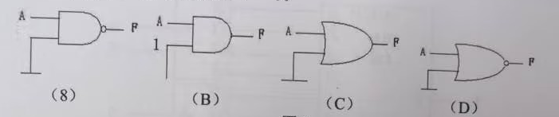
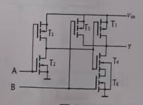
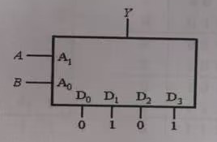
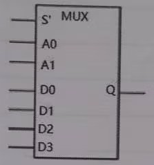
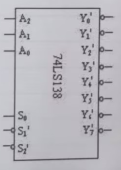
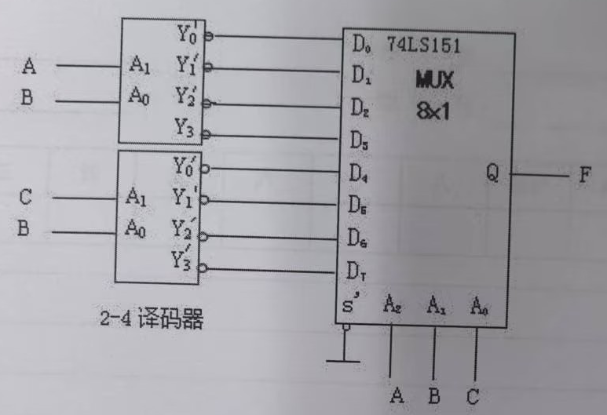
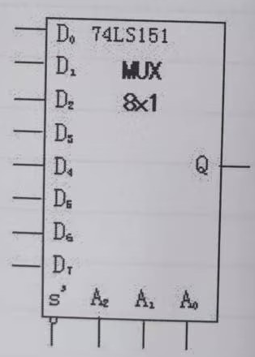

## 2025-2026学年上学期期中试卷

### 说明

根据“期中”目录中的印刷试卷照片整理，共 4 页；学年、学期和考试类型依收集者确认标注，所拍卷首未显示完整学期信息。保留原题符号、分值及器件图，功能表转写为表格。

### 一、填空题（16 分，每空 2 分）

1. $(-116.625)_{10}=(\underline{\qquad})_2=(\underline{\qquad})_{16}=(\underline{\qquad})_{\mathrm{BCD}}$。

    ***

2. $(-63)_{10}$ 用 8 位二进制表示的原码是 $\underline{\qquad}$，补码是 $\underline{\qquad}$。

    ***

3. OC 门称为集电极开路门，$\underline{\qquad}$（是／否）可把多个 OC 门输出端并联到一起，实现线与功能。

    ***

4. 74LS08 是 $\underline{\qquad}$ 类型的门电路，CC4069 是 $\underline{\qquad}$ 类型的门电路。（填 TTL 或 CMOS）

***

### 二、选择题（16 分，每题 2 分）

1. 逻辑函数 $S=(x'y(x'+z))'$ 可化简为（ ）。

    A. $x+y'+xz'$

    B. $x+y'$

    C. $(x'y)'+(x'yz)'$

    D. $x'y+x'yz$

    :::tip
    原题 A、B 两项等价，此处保留原题及选项。
    :::

    ***

2. 数字电路中除具有高电平、低电平两种状态外，还具有第三态即（ ）。

    A. 高阻态

    B. 低阻态

    C. 1 态

    D. 混合态

    ***

3. 与最小项 $ABCD$ 逻辑相邻的最小项有（ ）个。

    A. 4

    B. 5

    C. 6

    D. 7

    ***

4. 对于图 1 所示波形，所代表的逻辑关系为（ ）。

    

    A. 同或关系

    B. 异或关系

    C. 与关系

    D. 与或关系

    ***

5. 图 2 中输出 $F=A'$ 的电路是（ ）。

    

    :::tip
    原图最左侧的选项标记印成类似“(8)”的字符，按其位置对应 A 项，图中仍保留原貌。
    :::

    ***

6. 如图 3 所示的 CMOS 电路的功能是（ ）。

    

    A. $A+B'$

    B. $AB'$

    C. $A'+B$

    D. $A'B$

    ***

7. 图 4 为由数据选择器构成的函数发生器，其输出逻辑 $Y$ 等于（ ）。

    

    A. $Y=A+B$

    B. $Y=B$

    C. $Y=AB$

    D. $Y=A$

    ***

8. 逻辑函数 $F_1(A,B,C)=\sum m(2,4,5,6)$ 同 $F_2(A,B,C)=AB'+BC'$ 之间关系为（ ）。

    A. 相等

    B. 取反

    C. 对偶

    D. 不确定

***

### 三、化简题（共 24 分，每题 12 分）

1. 用卡诺图化简下列逻辑函数，写出最简“与或”表达式，并化成与非–与非形式。

    $$
    F(A,B,C,D)=\sum m(3,6,8,9,11,12)+\sum d(0,1,2,13,14,15).
    $$

    ***

2. 写出下列逻辑函数的最小项之和、最大项之积的形式，并用代数法化简：

    $$
    F(A,B,C,D)=ABD+A'BD'+A(CD)'+(AC)'D+BC'.
    $$

***

### 四、分析与设计题（44 分）

1. （32 分）设计用 3 个开关控制一个电灯的逻辑电路，要求改变任何一个开关的状态都控制电灯由亮变灭或由灭变亮。两个开关状态不可以同时改变。

    （1）（8 分）以 $A,B,C$ 表示三个双位开关，并用 0 和 1 分别表示开关的两个状态。以 $Y$ 表示灯的状态，用 1 表示亮，用 0 表示灭。设 $ABC=000$ 时 $Y=0$。据此列出 $Y$ 与 $A,B,C$ 之间逻辑关系的真值表。

    （2）（12 分）使用图 5 的 4 选 1 数据选择器设计，画出接线图。4 选 1 数据选择器的功能表类似于图 8 的 8 选 1 选择器。

    

    （3）（12 分）用 74LS138 和必要的门电路实现。已知 74LS138 的功能表和管脚图如图 6 所示。

    

    3–8 译码器的功能表（74LS138）：

    | $S_0$ | $S_1'+S_2'$ | $A_2$ | $A_1$ | $A_0$ | $Y_0'$ | $Y_1'$ | $Y_2'$ | $Y_3'$ | $Y_4'$ | $Y_5'$ | $Y_6'$ | $Y_7'$ |
    | --- | --- | --- | --- | --- | --- | --- | --- | --- | --- | --- | --- | --- |
    | $d$ | 1 | $d$ | $d$ | $d$ | 1 | 1 | 1 | 1 | 1 | 1 | 1 | 1 |
    | 0 | $d$ | $d$ | $d$ | $d$ | 1 | 1 | 1 | 1 | 1 | 1 | 1 | 1 |
    | 1 | 0 | 0 | 0 | 0 | 0 | 1 | 1 | 1 | 1 | 1 | 1 | 1 |
    | 1 | 0 | 0 | 0 | 1 | 1 | 0 | 1 | 1 | 1 | 1 | 1 | 1 |
    | 1 | 0 | 0 | 1 | 0 | 1 | 1 | 0 | 1 | 1 | 1 | 1 | 1 |
    | 1 | 0 | 0 | 1 | 1 | 1 | 1 | 1 | 0 | 1 | 1 | 1 | 1 |
    | 1 | 0 | 1 | 0 | 0 | 1 | 1 | 1 | 1 | 0 | 1 | 1 | 1 |
    | 1 | 0 | 1 | 0 | 1 | 1 | 1 | 1 | 1 | 1 | 0 | 1 | 1 |
    | 1 | 0 | 1 | 1 | 0 | 1 | 1 | 1 | 1 | 1 | 1 | 0 | 1 |
    | 1 | 0 | 1 | 1 | 1 | 1 | 1 | 1 | 1 | 1 | 1 | 1 | 0 |

    ***

2. （12 分，原题带 * 标记）分析图 7 所示电路，写出 $F$ 的逻辑函数式，并列真值表。其中 74LS151 的外部引脚图和功能表如图 8 所示；2–4 译码器功能类似于图 6 中 3–8 译码器功能。

    

    

    74LS151 功能表：

    | $S'$ | $A_2$ | $A_1$ | $A_0$ | $Q$ |
    | --- | --- | --- | --- | --- |
    | 1 | $\times$ | $\times$ | $\times$ | 0 |
    | 0 | 0 | 0 | 0 | $D_0$ |
    | 0 | 0 | 0 | 1 | $D_1$ |
    | 0 | 0 | 1 | 0 | $D_2$ |
    | 0 | 0 | 1 | 1 | $D_3$ |
    | 0 | 1 | 0 | 0 | $D_4$ |
    | 0 | 1 | 0 | 1 | $D_5$ |
    | 0 | 1 | 1 | 0 | $D_6$ |
    | 0 | 1 | 1 | 1 | $D_7$ |
