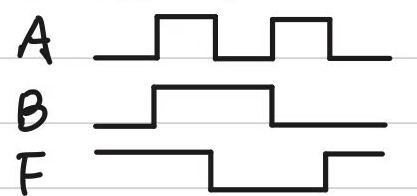
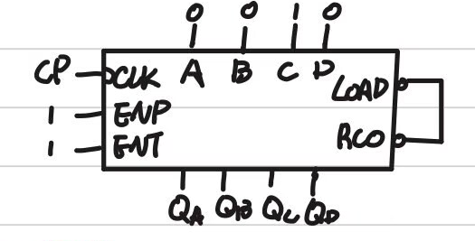
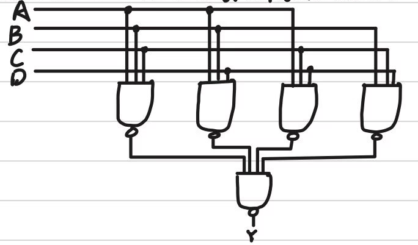
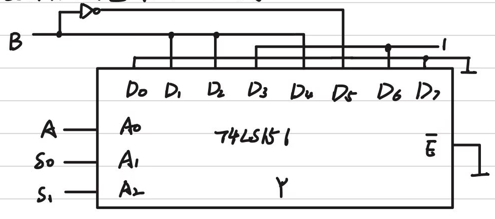
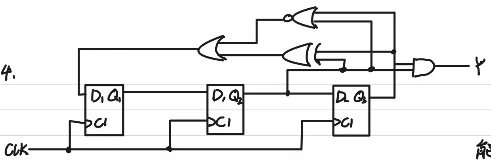

## 2025-2026学年上学期期末试卷（回忆整理）

### 说明

根据手写回忆稿整理，题目可能与原卷存在出入。回忆稿标注填空、选择分值均为 $2\times10$，分析第 4 题标有各部分分值，其余分析题和设计题未注明分值。电路图和波形图按原记录截取。

### 一、填空题（2×10）

1. 用 16 位二进制表示 $-2025$，最高位为符号位，二进制为 $\underline{\qquad}$，该二进制转化为八进制为 $\underline{\qquad}$；该二进制补码为 $\underline{\qquad}$，补码用十六进制表达为 $\underline{\qquad}$。

    ***

2. $F=(A+B+C)'D+AB(C'+D)$ 的对偶式为 $\underline{\qquad}$（不能化简）。

    ***

3. $F=\sum m(2,3,5,8,12)$ 的反函数用最大项表示为 $\underline{\qquad}$。

    ***

4. $A,B$ 为 16 位二进制数，比较大小用 $\underline{\qquad}$ 片 74LS85。

    自己参考书上的图。

    ***

5. 8 位移位寄存器的内容为 00101001，左移两次后高四位为 $\underline{\qquad}$。

    ***

6. 四位全加器，输入 $A_3A_2A_1A_0=1001$，$B_3B_2B_1B_0=1011$，$C_I=1$，输出和 $S=\underline{\qquad}$。

    ***

7. A/D 转换器的功能是 $\underline{\qquad}$。

***

### 二、选择题（2×10）

1. 输出端可线与的门电路是（ ）。

    A. OC 门

    B. 三态门

    C. TTL 与非门

    D. TTL 或非门

    ***

2. 下列（ ）不是触发器的触发方式。

    A. 电平触发

    B. 脉冲触发

    C. 边沿触发

    D. 主从触发

    ***

3. 下列与 $A'B+ABC$ 相等的式子为（ ）。

    A. $ABC$

    B. $1+BC$

    C. $A'B+BC$

    D. $A'+BC$

    ***

4. 下列 $A,B,F$ 波形图中，$F$ 的表达式为（ ）。

    

    A. $F=AB$

    B. $F=A+B$

    C. $F=A\oplus B$

    D. $F=A\odot B$

    ***

5. 逻辑函数恒等，哪一项一定相同？（ ）

    A. 逻辑图

    B. 真值表

    C. 逻辑表达式

    D. 波形图

    ***

6. 属于中规模时序逻辑器件的是（ ）。

    A. 编码器

    B. 移位寄存器

    C. 加法器

    D. 译码器

    ***

7. 在计算机系统中，数据总线由下列哪个门电路组成？（ ）

    A. 异或门

    B. OC 门

    C. 与非门

    D. 三态门

    ***

8. 下列可确定 $A,B,C$ 中有奇数个 1 的是（ ）。

    A. $A\oplus B\oplus C=1$

    B. $A+B+C=0$

    C. $A\oplus B\oplus C=0$

    D. $A+B+C=1$

    ***

9. 555 定时器构成多谐振荡器没有用到（ ）。

    A. 分压器

    B. 放电管

    C. 晶体振荡管

    D. RS 触发器

    ***

10. $D$ 为高位，计数器为模（ ）计数器。

    

    A. 10

    B. 11

    C. 12

    D. 13

***

### 三、分析

1. 用卡诺图化简

    $$
    F(A,B,C,D)=\sum m(0,2,3,5,6,7,8,9,10,15)+\sum d(4,11,14).
    $$

    ***

2. 对下图进行分析：

    

    （1）求逻辑函数。

    （2）列出真值表。

    （3）分析功能。

    ***

3. 当 $S_0,S_1$ 取不同值时，求 $Y$ 与 $A,B$ 的关系。

    

    ***

4. 分析下图电路，写出驱动方程、状态方程、输出方程（7 分）；列出状态转换表，画出状态转换图，说明功能（7 分）；判断能否自启动（1 分）。

    

***

### 四、设计

1. 用 3–8 译码器加部分门电路实现：当输入有奇数个 1 时，灯亮。

    ***

2. 用 JK 触发器实现输出“0101010”序列，要求电路自启动。设计出逻辑电路图、状态转换表、状态转换图。
