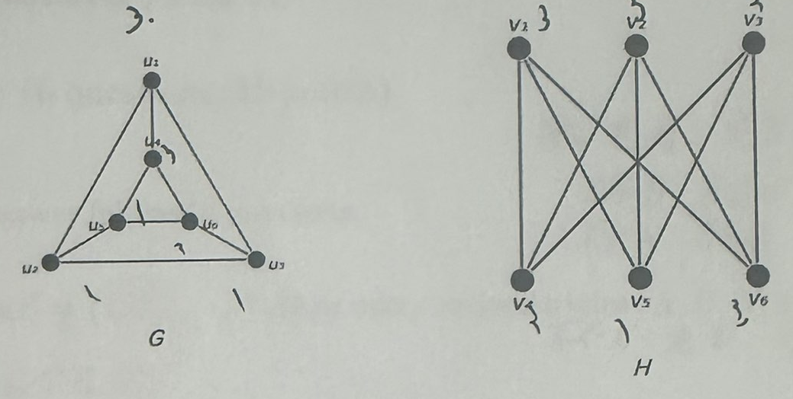
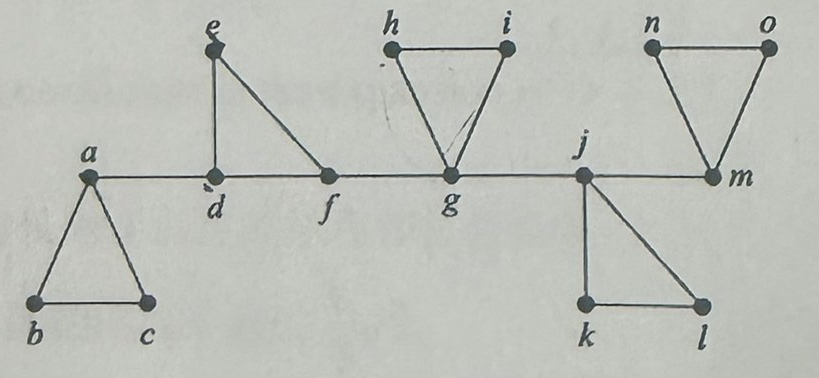
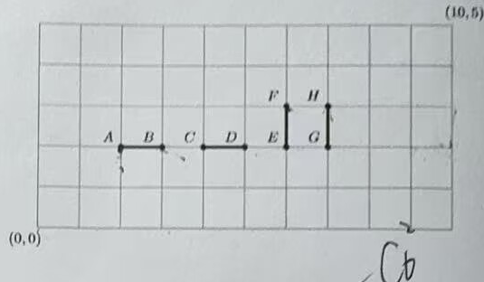
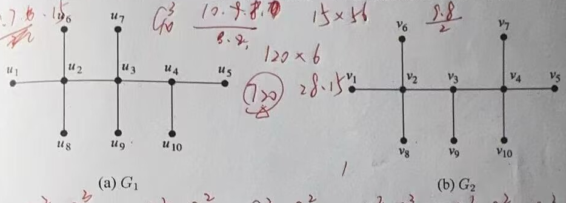
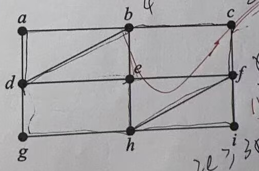
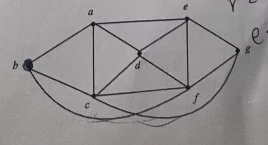

## 2025-2026学年下学期期末试卷——张民

### 说明

根据“张民老师班”目录中的试卷照片整理。照片包含第 1—4 页，其中第 3、4 页各有两张重复照片；第 5 页缺失，第 14 题配图及第 15 题缺失。保留原卷中英文题面、题号和分值，照片中的手写作答与批改未作为参考答案收录；配图中无法与印刷线条分离的笔迹暂保留。

### 一、Logic, Sets, Functions and Relations（4 questions, 30 points）

1. （6 points）Show the following statement.

    Premises: $(\exists x)A(x)\to(\forall x)((B(x)\lor A(x))\to C(x))$; $(\exists x)A(x)$

    Conclusion: $(\exists x)C(x)$

    ***

2. （8 points）回答下列问题：

    (a) 请建立 $[0,1]$ 到 $[-1,1]$ 的双射；

    (b) 请建立 $[0,1]$ 到 $(0,1]$ 的双射。

    ***

3. （6 points）考虑偏序集 $(S,\leq)$，其中 $S=\{1,2,\ldots,n\}$，$\leq$ 为通常的大小关系（全序）。设 $A\subseteq S$，定义 $A$ 的上闭包

    $$
    \uparrow A=\{x\in S:\exists a\in A,\ a\leq x\},
    $$

    下闭包

    $$
    \downarrow A=\{x\in S:\exists a\in A,\ x\leq a\}.
    $$

    对 $S=\{1,2,3,4,5\}$ 和 $A=\{2,4\}$，计算 $\uparrow A$、$\downarrow A$、$\uparrow A\cap\downarrow A$ 的值。

    ***

4. （10 points）设 $f:A\to B$ 是一个从集合 $A$ 到集合 $B$ 的函数。在集合 $A$ 上定义关系 $R_f$ 如下：

    $$
    R_f=\{(x,y)\in A\times A\mid f(x)=f(y)\}.
    $$

    （1）（6 points）证明：$R_f$ 是 $A$ 上的等价关系。

    （2）（4 points）证明：对任意 $b\in\operatorname{ran}(f)$，原像集 $f^{-1}(\{b\})$ 是 $R_f$ 的一个等价类。

    注：$\operatorname{ran}(f)$ 表示函数 $f$ 的值域。

***

### 二、Counting（6 questions, 45 points）

5. （9 points）Answer following questions:

    (a) Suppose $S=\{1,2,\ldots,n\}$. How many ordered triples $(A,B,C)$ are there such that $A\subseteq B\subseteq C\subseteq S$?

    (b) Suppose $n$ is a positive integer. How many functions are there from the set $\{1,2,\ldots,n\}$ to the set $\{1,2,3\}$ that are onto?

    (c) Find the largest coefficient in the expansion of $(x+3)^5$.

    ***

6. （5 points）在一个边长为 2 的正方形内部任意放置 10 个点。请证明：必定存在至少两个点，它们之间的距离不超过 $\dfrac23\sqrt2$。

    ***

7. （9 points）Find the generating function for the sequence $\{p_n\}$, where $p_n$ denotes the number of non-negative integer solutions to each of the following equations:

    (a) $x_1+x_2+\cdots+x_k=n$, where $0\leq x_i\leq3$, $i=1,2,\ldots,k$.

    (b) $x_1+2x_2+\cdots+kx_k=n$.

    (c) $x_1+x_2+\cdots+x_k=n$, where $x_1\geq x_2\geq\cdots\geq x_k\geq0$.

    ***

8. （6 points）A matrix is “good” if in each row there are no repeated elements, and in each column there are no repeated elements. How many “good” matrices are there with 2 rows and 5 columns, where all of their elements are from $\{1,2,3,4,5\}$?

    ***

9. （8 points）Let $S_n=\{1,2,\ldots,n\}$ and let $a_n$ denote the number of non-empty subsets of $S_n$ that contain no two consecutive integers.

    (a) Find a recurrence relation for $a_n$ and give the initial condition.

    (b) Solve the recurrence relation.

    ***

10. （8 points）Consider the linear nonhomogeneous recurrence relation:

    $$
    a_n-5a_{n-1}+6a_{n-2}=F(n).
    $$

    State the form of a particular solution for each of the following cases:

    (a) $F(n)=3^n+2^n$

    (b) $F(n)=n^2 3^n$

    (c) $F(n)=7^n$

    (d) $F(n)=(n^3+1)2^n$

***

### 三、Graphs（5 questions, 25 points）

11. （7 points）The complete m-partite graph $K_{n_1,n_2,\ldots,n_m}$ has vertices partitioned into $m$ subsets of $n_1,n_2,\ldots,n_m$ elements each, and vertices are adjacent if and only if they are in different subsets in the partition.

    (a)（1 points）What is the chromatic number of $K_{n_1,n_2,\ldots,n_m}$?

    (b)（2 points）Please draw $K_{1,2,2}$. How many vertices and edges does it have?

    (c)（4 points）Does $K_{3,2,2,4}$ have Euler Parth or Euler Circuit? Please explain.

    ***

12. （7 points）请回答下列问题：

    (a)（4 points）设 $G$ 是 $n$ 个顶点的简单图，且 $G$ 与它的补图 $\overline G$ 同构。证明 $n(n-1)$ 必须能被 4 整除。

    注：对于简单图 $G=(V,E)$，其补图为 $\overline G=(V,\overline E)$，其中 $\overline E$ 包含所有在 $G$ 中不存在的边（即完全图 $K_n$ 减去 $G$ 的边）。

    (b)（3 points）判断下列两个图 $G$ 和 $H$ 是否同构。请说明你的理由。

    

    ***

13. （6 points）Please answer the questions considering the graph given below:

    

    (a)（4 points）Please list all the cut vertices and cut edges;

    (b)（2 points）Does the given graph have a Hamilton circuit or Hamilton path? If yes, please provide one. Otherwise, please explain.

    ***

14. （5 points）判断下图是否是平面图。如果是，请画出其平面表示，如果不是，请说明原因。

    配图缺失（第 5 页缺失）。

    ***

15. 缺失（第 5 页缺失）。

***

## 2025-2026学年下学期期末试卷——其他老师班

### 说明

根据“其他老师班”目录中的试卷照片整理，共 4 页。照片未拍到完整卷首，学年、学期和版本归属依收集目录标注，教师姓名及卷别未确认。保留原卷中英文题面、题号和分值；图中可见手写作答或批改痕迹，不作为参考答案。

### 一、Logic, Sets, Functions and Relations（5 questions, 30 points）

1. （4 points）判断下列各对公式是否等值，若等值，请给出证明，若不成立，请给出反例。

    (a) $\forall xP(x,x)$，$\forall x\forall yP(x,y)$

    (b) $\neg(\forall xF(x)\lor\exists yG(y))$，$\exists y\neg F(y)\land\forall x\neg G(x)$

    ***

2. （4 points）试用一阶谓词逻辑描述下列命题结构（要求使用全总个体域）。

    (a) 并不是所有的北京人都去过颐和园（要求：只能使用存在量词）。

    (b) 不存在比一切实数都大的实数。

    ***

3. （8 points）设 $X$ 为集合，$A=P(X)-\{\varnothing\}-\{X\}$ 且 $A\ne\varnothing$，若 $|X|=n$，问：

    (a) $(A,\subseteq)$ 是偏序集吗？若是，回答下列问题：

    (b) 偏序集 $(A,\subseteq)$ 是否有最大元？

    (c) 偏序集 $(A,\subseteq)$ 是否有最小元？

    (d) 偏序集 $(A,\subseteq)$ 中极大元和极小元的一般形式是什么？并说明理由。

    说明：$P(X)$ 代表集合 $X$ 的幂集。

    ***

4. （8 points）设 $R$ 是一个二元关系。令

    $$
    S=\{(a,b)\mid\text{存在某个 }c,\text{ 有 }(a,c)\in R\text{ 且 }(c,b)\in R\}.
    $$

    证明：若 $R$ 是等价关系，则 $S$ 也是等价关系。

    ***

5. （6 points）证明：有限集 $A$ 与可列集 $B$ 的笛卡尔积 $A\times B$ 是可列集。

    :::tip
    本题中“可列集”包含有限集（含空集）与可列无限集。
    :::

***

### 二、Counting（6 questions, 45 points）

6. （6 points）Answer following questions:

    (a) Suppose that $S$ is a set with $n$ elements. How many ordered pairs $(A,B)$ are there such that $A\subseteq S$, $B\subseteq S$ and $A\cap B=\varnothing$?

    (b) What is the coefficient of $x^5$ in the expansion of $\left(x^2-\dfrac1x\right)^7$?

    ***

7. （6 points）按要求完成下列题目：

    (a) 在边长为 1 的正三角形中任选五点，证明存在两点，其距离不超过 $1/2$。

    (b) 在边长为 1 的正三角形中任选 10 点，证明存在两点，其距离不超过 $1/3$。

    (c) 在边长为 1 的正三角形中任选 $n^2+1$ 个点，证明存在两点，其距离不超过 $1/n$。

    ***

8. （11 points）Find the number of integer solutions for each of the following problems:

    (a) $x_1+x_2+\cdots+x_6=10$ with $x_1,\ldots,x_6>0$.

    (b) $x_1+x_2+\cdots+x_6<10$ with $x_1,\ldots,x_6>0$.

    (c) $x_1\times x_2\times\cdots\times x_6=10$ with $x_1,\ldots,x_6>0$.

    (d) $x_1^2+x_2^2+\cdots+x_6^2=3$ with $x_1,\ldots,x_6\in\mathbb Z$.

    ***

9. （8 points）在下图所示的地图中，起点为 $(0,0)$，终点为 $(10,5)$，且只能向上移动，或者向右移动。其中 $A(2,2)$、$B(3,2)$、$C(4,2)$、$D(5,2)$、$E(6,2)$、$F(6,3)$、$G(7,2)$、$H(7,3)$。

    

    (a) 计算从起点 $(0,0)$ 到终点 $(10,5)$ 的路径数目。（说明：每一条路径都会包含向右移动 10 次，且向上移动 5 次。）

    (b) 计算不能经过 $AB,CD,EF,GH$ 的路径数目。

    ***

10. （8 points）用红、蓝、白三种颜色对 $1\times n$ 的方格涂色，每个方格只能涂一种颜色，如果要求涂成红色的两个方格不能相邻，问有多少种方法？

    要求：请用构造递推关系的方法完成此题。

    ***

11. （6 points）准备一个果篮，水果可选自苹果、橙子、香蕉和梨，其中要求苹果的个数是偶数，橙子的个数是 5 的倍数，至多有 4 个香蕉，至多有一个梨。$h_n$ 是满足上述条件的果篮数目，其中 $n$ 表示果篮中水果的总个数。

    （1）给出 $h_n$ 的生成函数。

    （2）从这个生成函数出发求 $h_n$ 的公式。

***

### 三、Graphs（6 questions, 25 points）

12. （4 points）下列图分别有多少个顶点和边？并说明对于哪些 $n$ 值来说，下列图是二分图？

    (a) $K_n$

    (b) $C_n$

    ***

13. （5 points）证明：在一个连通的平面图中，若每个面（包括外部区域）都被三条边围成，则该图的边数 $e$ 与顶点数 $v$ 满足关系式 $e=3v-6$。

    ***

14. （4 points）请判断下面两图是否同构？构造一个同构或者给出不存在同构的证明。

    

    ***

15. （2 points）请写出上题中的图 $G_1$ 的割点和割边。

    ***

16. （5 points）Determine whether the given graph has an Euler circuit. Construct such a circuit when it exists. If no Euler circuit exists, determine whether the graph has an Euler path and construct such a path if it exists.

    

    ***

17. （5 points）Prove the following graph is nonplanar（非平面图）.

    

    :::tip
    图中下方两条弧线分别连接 $b$ 与 $f$、$g$ 与 $c$，交叉处不是顶点。
    :::
